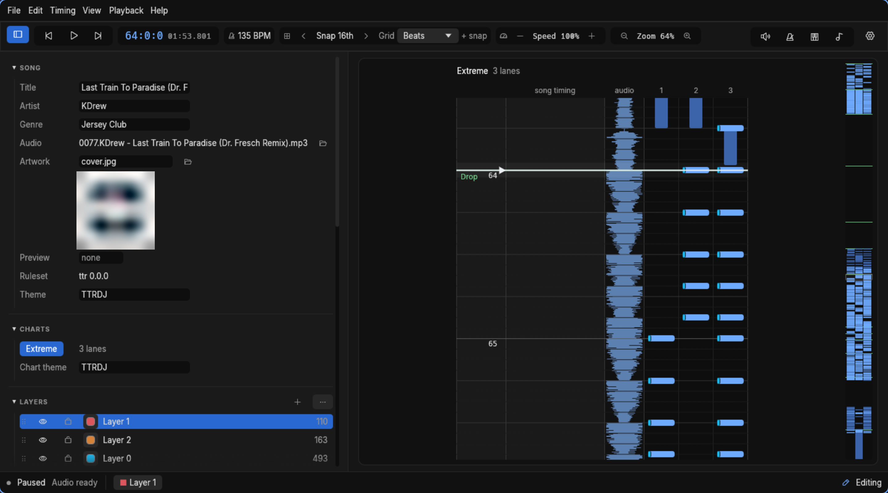

#  Charter

[](https://github.com/cN3rd/charter/actions/workflows/ci.yml)
[](https://github.com/cN3rd/charter/releases)
[](#build-from-source)
[](#licence)

Charter is a versatile rhythm game charting program, aimed at making charting as easy and fun as
possible. It currently supports mostly Tap Tap Revenge and its variants, with more to come later on.

**[Download builds](https://github.com/cN3rd/charter/releases)** |
[User guide](https://cn3rd.github.io/charter/guide/index.html) |
[Contributing](CONTRIBUTING.md) |
[Report a bug](https://github.com/cN3rd/charter/issues)

[](docs/src/guide/images/window.png)

## Try it

1. Download a [development build](https://github.com/cN3rd/charter/releases) for **64-bit Windows or Linux**.
2. Unpack it and run `charter.exe` (Windows) or `./charter` (Linux). No installer needed.
3. Choose **Open the demo song** to look around without any files, or
   [make your first chart](https://cn3rd.github.io/charter/guide/first-chart.html) with your own audio.

> [!WARNING]
> These are prereleases. Things can break, and the song format may change without notice.
> Keep backups of your work. Keep the Charter `.json` song as your editable original;
> game exports merge layers without warning.

Report bugs on [GitHub Issues](https://github.com/cN3rd/charter/issues), with the version and
commit from **Help > About charter**.

## What's here

- Place notes with the keyboard, or record them while the song plays.
- Line up the beat grid in the waveform timing window, or let Beat This! or Mapperatorinator
  suggest timing from the audio. Each asks before downloading its model. Both run locally;
  your audio is not uploaded.
- Slow playback without changing pitch, and listen with a metronome or note ticks.
- Split notes into layers, undo edits, and recover unsaved work.

## Game support

| Game | Current support |
| --- | --- |
| **Tap Tap Revenge and variants** | Editing, plus `.ttr2_track` and Editor on Fire MIDI import/export |
| StepMania | Editing; no native chart import/export yet |
| osu!mania | Editing; no native chart import/export yet |

osu! timing can be imported into any song. See
[Games, import and export](https://cn3rd.github.io/charter/guide/games.html) for details and conversion limits.

Audio conversion for Tap Tap Revenge exports may need [ffmpeg](https://ffmpeg.org/);
Charter offers setup help if it's missing.

## A caveat about LLMs

LLMs help build Charter, and parts of it are vibe-coded. The aim is to move quickly and make
meaningful software while keeping AI-generated "slop" to a minimum. Refactoring is ongoing:
making the code faster and more accurate, and cutting AI-related clutter.

Human audits are happening between prereleases. The hope, not a guarantee, is to reach a future
release with most of the code vetted through human-AI collaboration.

AI assistance is welcome; responsibility stays with the human submitting the change.
The [contribution policy](docs/src/contributing.md) covers licensing, AI disclosure and verification.

## Build from source

You'll need Rust 1.95 or newer. On Linux, also install clang, mold, pkg-config and the ALSA
development headers (`libasound2-dev` on Debian and Ubuntu).

From a clone of this repository:

```sh
cargo run --release -p charter-app
```

The [packaging notes](https://cn3rd.github.io/charter/packaging.html) cover release packages.

## Licence

Licensed under [MIT](LICENSE-MIT) or [Apache-2.0](LICENSE-APACHE), at your option.
