# Charting

## Moving around

The cursor is the bright line across the notefield. Notes go on it, and playback starts from it.

| To move | Use |
|---|---|
| By one snap | Up and Down, or the mouse wheel |
| By a measure | Page Up and Page Down, or Shift with the wheel |
| To the start, or to where the last note ends | Home, End |
| To the previous or next section | Alt+Up, Alt+Down |
| Anywhere | Click or drag the minimap, or drag the cursor's handle on the ruler |

Left and Right change the snap: 4th, 8th, 12th, 16th, 24th, 32nd, 48th, 64th, 96th or 192nd
notes, shown on the toolbar. Ctrl with the wheel, Ctrl+Plus and Ctrl+Minus zoom. Dragging with
the middle button pans by moving the cursor, and seeks the audio if the song is playing.

## Placing notes

The number keys 1 to 9 and 0 are the lanes from left to right; each lane header shows its key.

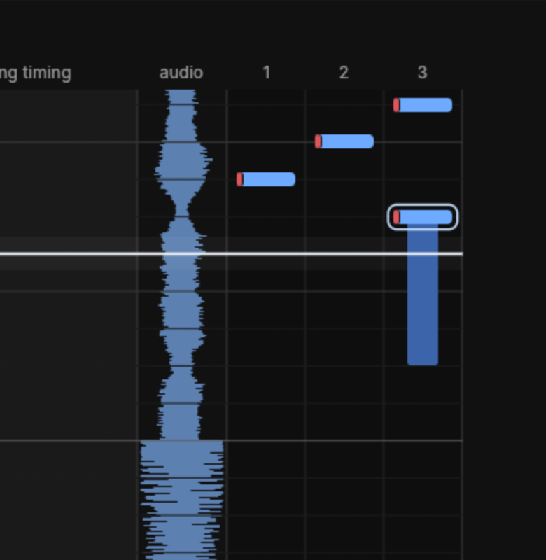

- A lane key places a tap on the cursor, or removes the note already there.
- Keys pressed together place a chord. Once they are all up the cursor moves on one snap, ready
  for the next note. The Editing page of the settings turns that off.
- Holding a lane key while moving the cursor stretches the tap into a hold.
- Shift with a lane key places a mine, in games that have them.
- With the mouse: Ctrl+click places or removes a tap, Ctrl+Shift+click a mine, and Ctrl+drag
  along a lane draws a hold.
- `]` lengthens the selected notes, or the notes at the cursor, by one snap, making a tap a
  hold; `[` shortens them back.

Lane keys work during playback too. Each note lands on the snap line nearest what you heard,
allowing for the input latency you [calibrated](listening.md#latency), and a key held past
200 ms grows into a hold until it comes up.

Every edit is checked against the chart format and the game's rules. An edit the game could not
play — a Tap Tap Revenge shake outside the lane of its direction, say — is refused: a message
says why, and the note in the way flashes.

## Selecting and editing

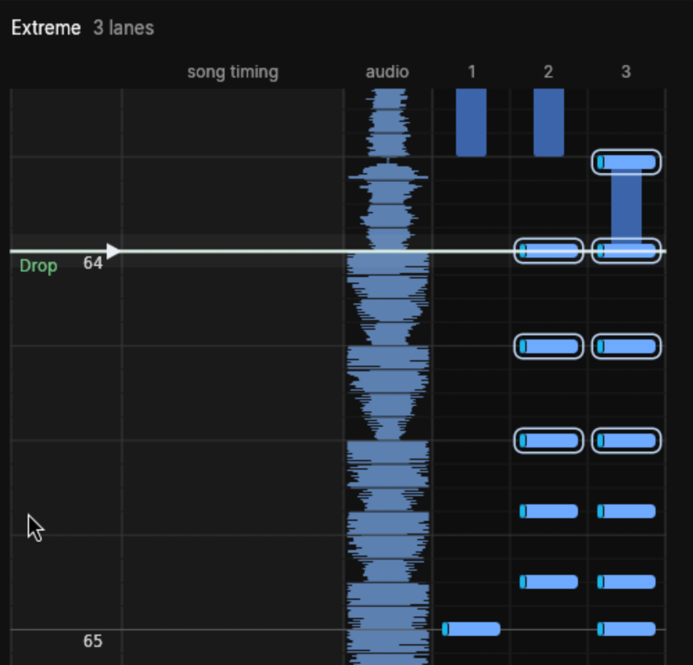

- A click selects a note; a drag across empty space selects every note it boxes from shown,
  unlocked layers. Shift adds to the selection and Alt takes from it. Ctrl+A selects every
  editable note, Escape none.
- Dragging a note moves it, or the selection it is in, by whole snaps and across lanes, with an
  outline showing where the notes will land. Shift keeps their time and moves them across lanes
  only.
- Delete or Backspace removes the selection.
- Ctrl+X, Ctrl+C and Ctrl+V cut, copy and paste at the cursor. Copies go on the system clipboard
  too, so another charter window can paste them. Ctrl+D duplicates the selection just after
  itself.
- Ctrl+Left and Ctrl+Right move the selection a lane, Ctrl+Up and Ctrl+Down by one snap, Ctrl+M
  mirrors it across the lanes, and G snaps it to the nearest snap lines — the one to reach for
  after charting by ear.

A right-click opens the same edits without moving the cursor, plus three things that live only
here:

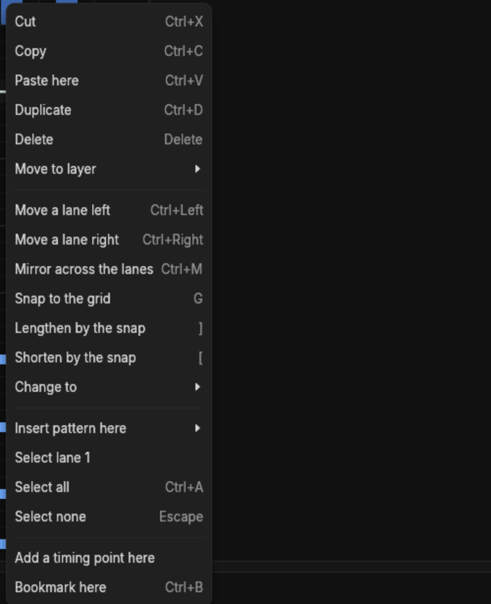

- **Move to layer** sends the selection to another [layer](../layers.md).

  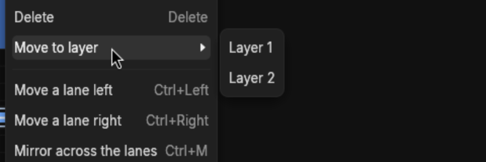

- **Change to** holds the note kinds of the song's game. Tap Tap Revenge offers Arrow, which
  turns a note into the shake of its lane, Slice, Big tap across every lane, and Tap.

  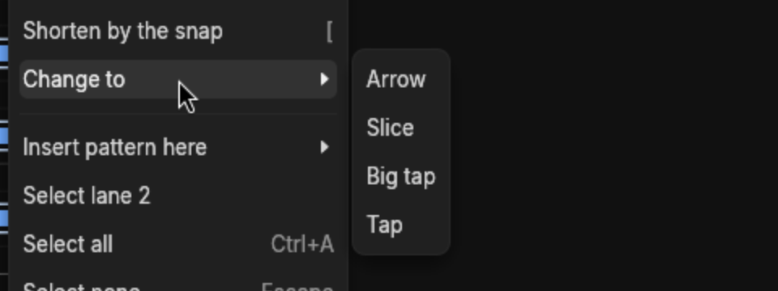

- **Insert pattern here** fills a run from the lane clicked — 1-1-1-1, 1-2-3-1-2-3 or 1-2-1-2 —
  at a spacing from a beat down to a 64th of one.

  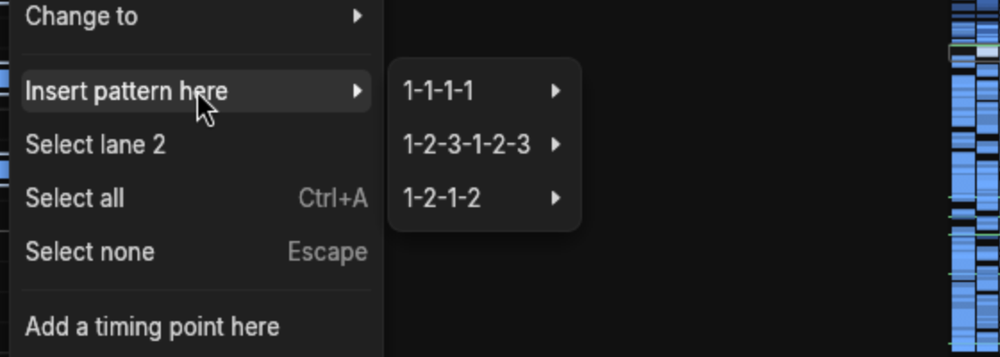

Patterns and **Select lane** appear only when the click landed on a lane. A click on the ruler,
the timing column or the audio strip still offers pasting, a timing point and a bookmark at the
line clicked.

Pastes and patterns go on the line clicked, on the active layer. They skip occupied starting
positions on that layer; a collision with a note on another layer refuses the whole operation,
even if that layer is hidden. A hidden, ghosted or locked active layer refuses placement too.

Ctrl+Z undoes and Ctrl+Shift+Z or Ctrl+Y redoes, one edit at a time. Each takes you back to the
chart and the place the edit was made, so the change is in view.

## Layers

A chart's notes can be split into named, coloured layers: one per instrument, or one per idea
you are trying out. Each layer can be shown, ghosted, hidden, soloed or locked on its own.

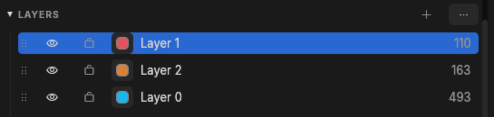

Each row carries a drag handle, an eye, a lock, a colour swatch, the name and how many notes are
on it. The `+` adds a layer and the `…` opens the rest:

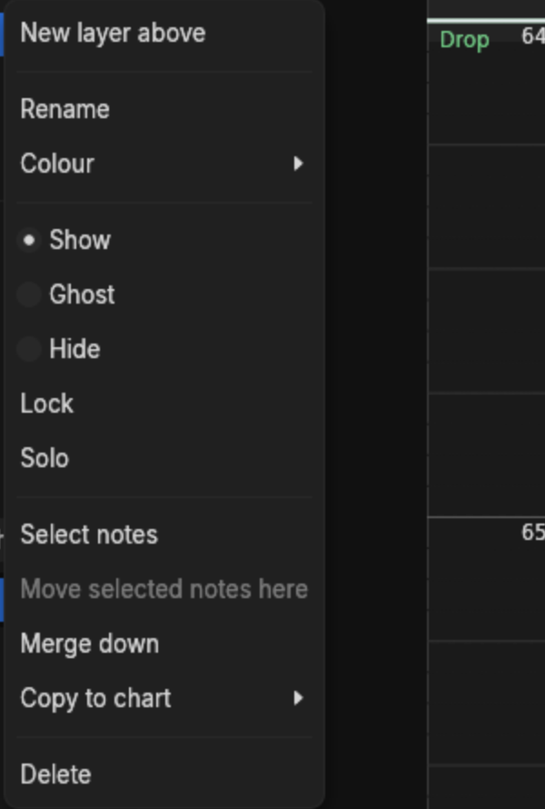

**Copy to chart** copies the layer, notes and all, into another chart of the same song — the way
to start a Hard from a finished Extreme.

Alt+1 to 9 makes a layer active, so new notes go there; Alt+Shift+1 to 9 moves the selected
notes to it. View > Colour notes by layer tints whole notes in their layer's colour; without it
each note carries only a short stripe of that colour along one edge.
[Layers](../layers.md) describes the model in full.

A layer's visibility is saved in the song, so changing it counts as an edit. In a read-only song
the list still lets you choose a layer and select its notes, but adding, renaming, recolouring,
reordering, showing, hiding and locking are all disabled. The lock icon stays legible in either
state, and its button tells a screen reader whether the layer is locked.

## The song panel

The panel on the left holds everything about the song that is not a note. Each change in it is
one undo step. A value typed into a field takes effect on Enter or when you leave the field;
Escape puts it back, and a refused layer name stays in its field so you can correct it. Clicking
a section's title folds it, and the panel remembers which are folded.

### Song

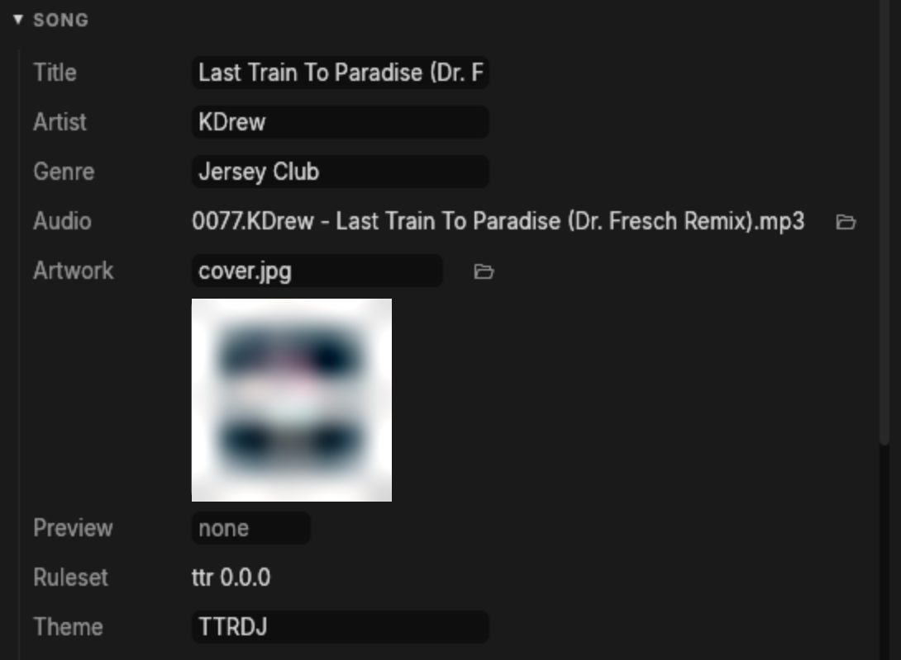

The title and artist; the audio, with a button to choose another file; the preview, which is the
time and length a song list plays; and the artwork, a PNG or JPEG beside the song. The artwork
button takes a picture, or an audio file whose tags hold a cover, which charter saves beside the
song as `cover.jpg` or `cover.png`. A song with no artwork takes the cover of the audio you
choose for it. Settings the game keeps as text, such as Tap Tap Revenge's theme, follow.

### Charts

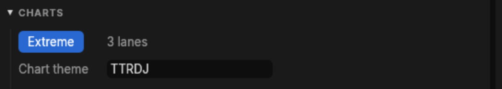

The song's charts, and the settings the game keeps for each. Switching chart keeps the cursor
where it is, so you can compare two difficulties at one spot.

### Layers, Timing and Markers

Layers are above; [Timing](timing.md) and the markers list have their own chapters and sections.

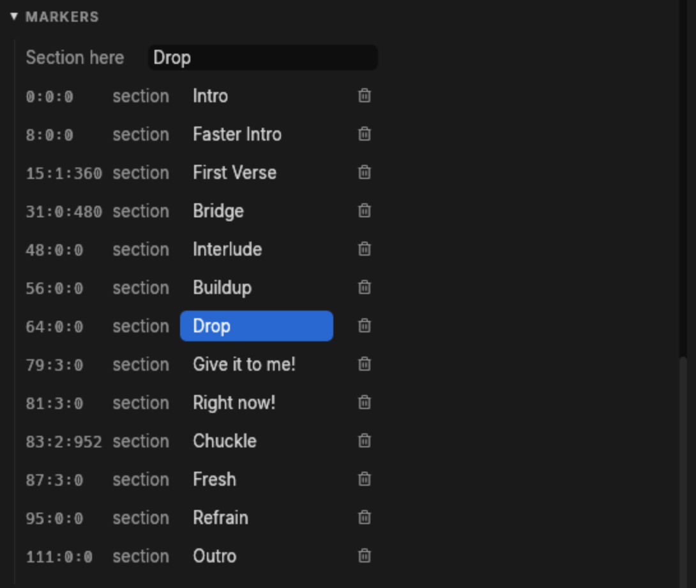

Markers are the song's sections and bookmarks. A click jumps there. A name typed into *Section
here* names the section at the cursor, or starts one, on Enter or when you leave the field;
Escape discards the draft. Ctrl+B adds or removes a bookmark at the cursor.

### Chart settings and Samples

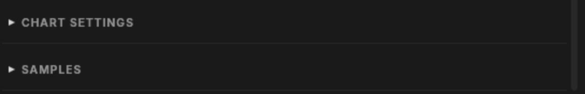

Both stay folded until you open them, and both are for reading: the open chart's remaining
settings, such as a StepMania meter, and the song's keysounds. A chart whose every setting
already has a field under Charts has no Chart settings section at all.
