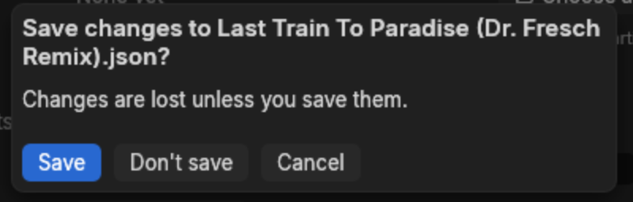
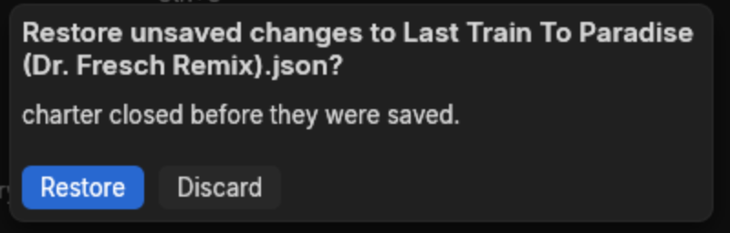

# Files and recovery

## A song on disk

A song is one `.json` file, with its audio and artwork beside it. Saving a song somewhere new
makes it a folder: choosing `Anthem` writes `Anthem/Anthem.json`, copies the audio in — keeping
any subfolder it sat in relative to the song — and writes the artwork. Choosing the song's own
file in its folder saves over it.

A save that would lose something stops instead and says why: different audio already at the
destination, a copy that fails, or another picture under the artwork's name that this song did
not name. A song whose file would pass 64 MiB, a few hundred thousand notes, stops too, since
charter opens no larger file. Saves write beside the song and then move over it, so a failed
save leaves the old file untouched.

An export to another program's format says it is exporting while its files are written, and
reports success only once the main file, the files beside it and the copied resources are all
written. If one fails, charter names the file that was not written instead.

Once a song has been saved and its audio sits inside the song's own folder, charter keeps what
it works out from that audio — the waveform and the onsets — in a `cache` folder beside it, so
the next open shows them at once. Audio that lives elsewhere, such as a file you chose from your
music collection before saving, is worked out afresh each time, so that nothing is written among
your own files. Deleting a `cache` folder costs only the time to work its contents out again.

The title bar marks a song with unsaved changes with a star. Closing the window, opening another
song or starting a new one asks first:

A song stays in Open recent after a permission or drive error, or if its contents turn out to be
invalid, so you can try it again. Only a file the system reports as missing leaves the list.

## The data folder

Charter keeps its own files in `%APPDATA%\charter\data` on Windows, and on Linux in
`$XDG_DATA_HOME/charter`, which is `~/.local/share/charter` unless you have set that variable.
The Autosave settings page names the folder actually in use. It holds:

- `app.ron`, the settings — only those changed from their defaults;
- `recovery.json`, the autosave, and `recovery-unreadable.json`, one that a later start could
  not read;
- the timing models' weights, once downloaded;
- `snapshots`, when snapshots in a folder are turned on;
- `crash-<number>.txt`, a report for each crash.

## Autosave

Half a minute after a change, charter writes the unsaved song to `recovery.json`. The Autosave
settings page moves that wait anywhere from 5 seconds to 10 minutes, or turns it off.

Saving the song, undoing back to the saved version, or throwing the changes away removes the
file. If charter closes without any of those happening — a crash, or the power going — the next
start offers the work back:

**Restore** reopens the song with those changes, still unsaved, against the file they belong to.
An autosave that the start cannot read is not thrown away: charter says so and moves it to
`recovery-unreadable.json` beside it, where later autosaves leave it alone for repair.

## Snapshots

Snapshots keep a history rather than a single rescue copy. Every few minutes — 5 unless the
Autosave page says otherwise — a changed song is copied with the date and time in its name, such
as `Anthem 2026-09-29 05.40.12 UTC.json`:

- **in a folder**, `snapshots/<song>` in the data folder or in a folder you choose;
- **beside the song**, in an `autosaves` folder next to the song's file, once it has been saved.

Both are off to start, and each switches on by itself. A song unchanged since its last copy is
not copied again, and each folder keeps the newest 20 copies of a song unless the page says
otherwise.

A snapshot holds the chart JSON only, not copies of its audio, artwork or samples. Their paths
stay relative to the JSON file, so opening a snapshot where it sits, in `snapshots` or
`autosaves`, looks for those files in the wrong folder.

To restore one, copy it into the original song's folder under a different name, such as
`Anthem-restored.json`, and open that copy; the audio, artwork and samples then resolve beside
the original. Keep the current JSON until you are sure you want to replace it. For a song that
was never saved, choose its audio and artwork again and put any sample files at the paths the
snapshot names, since it does not keep the paths you originally chose or unsaved artwork bytes.

## Crashes

If charter crashes it writes `crash-<number>.txt` to the data folder, saying what went wrong and
where, and a dialog names the file before the window closes. Attach that file to a report on the
[issue tracker](https://github.com/cN3rd/charter/issues), along with the version and commit from
Help > About charter. The last autosave is offered on the next start.
