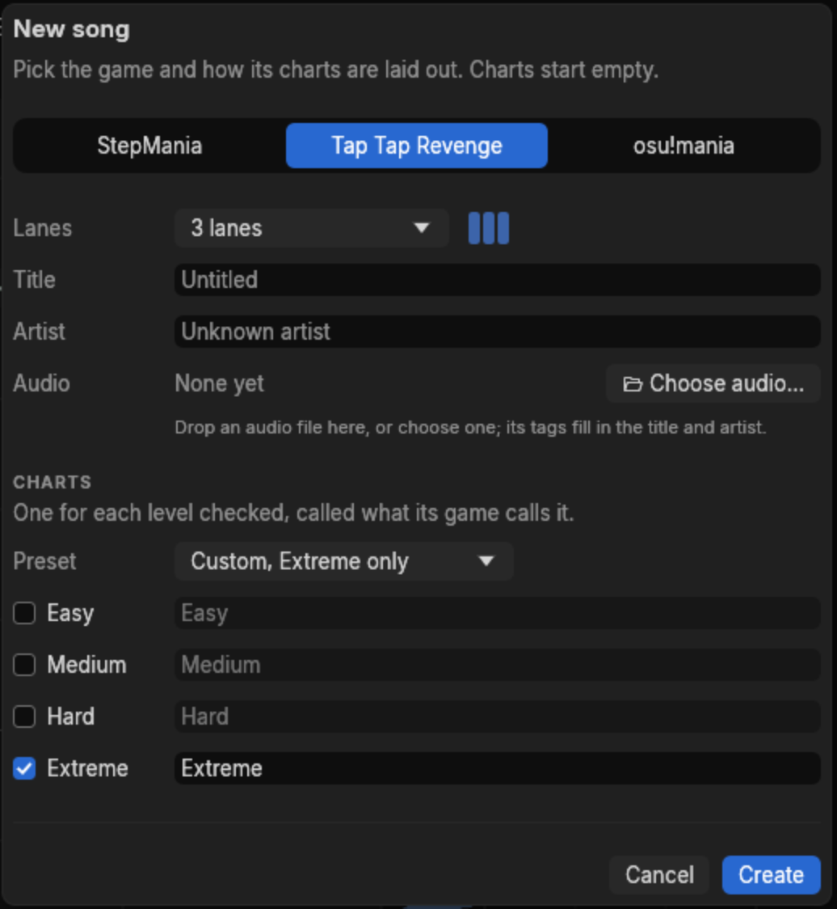
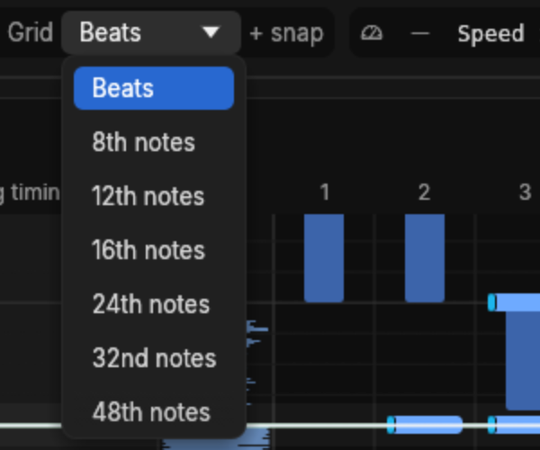

# Your first chart

This chapter charts one song from start to finish. The screenshots follow a three-lane Tap Tap
Revenge chart of KDrew's *Last Train To Paradise (Dr. Fresch Remix)*, a Jersey club track at
135 BPM. Use any song you like; only the numbers change.

If you have no audio handy, Help > Open the demo song gives you a made-up song that is already
timed, with two charts, a tempo change, a stop and a spell of 7/8 — a safe place to try steps 4
to 8 on. It has no audio of its own, so playback, the waveform and the timing finders have
nothing to work with there.

## 1. Make the song

**File > New song…** (Ctrl+N). Pick the game, then the layout, then give it the audio: drop the
file on the dialog, or use **Choose audio…**, which is the only way under Wayland, where
charter cannot yet receive dropped files. The title and artist come from the file's tags.

For this song: Tap Tap Revenge, 3 lanes, the Extreme level only. Press **Create**.

The editor opens on an empty chart. Once the audio has been decoded the status bar says
`Audio ready`, and the waveform appears in the strip beside the lanes.

## 2. Find the beat

A new song is 120 BPM starting at 0 ms, which is almost certainly wrong for your audio. Three
ways to fix that, easiest first.

### Let charter listen

**Timing > Find timing with Beat This!…** reads the audio and works out a tempo map. The first
run downloads an 81 MB model; the song itself is never sent anywhere. The status bar shows how
it is going, and you can carry on editing while it thinks.

It comes back with an offer rather than a change:

**Use it** replaces the chart's timing in one step, which Ctrl+Z takes back. Always check an
accepted timing before charting on it — step 3.

### Copy it from somewhere else

If the song already has an osu! beatmap, **Timing > Import timing…** takes its `[TimingPoints]`
block, pasted or read from an `.osu` file, and shows what it would do before doing it.

### Do it by hand

Open the song panel's **Timing** section.

1. Set **Starting BPM** to the song's tempo. If you do not know it, tap along and count, or use
   one of the finders above.
2. Nudge **Offset** until the first beat of the grid lands on the first beat you hear. Alt+Left
   and Alt+Right move it a millisecond at a time, Shift makes that ten. The hint under the field
   says which way to go: raise the offset if the notes come early.

This song ends up at 135 BPM with an offset of 23 ms.

## 3. Check the timing before you chart

A tempo that is close is not a tempo that is right. The error accumulates: a grid that is a
fraction of a BPM out looks fine over the first few bars and drifts further from the music the
longer the song runs. **Timing > Timing window** (Ctrl+T) is where you find that out before you
have charted four minutes on top of it.

It lays the audio out in rows with the beat grid drawn over it. A grid that fits the music lines
up with the loud moments down every row.

The window finds the **onsets** in the audio — the moments a sound starts — and measures the
grid against them. The list on the right is what it did not like:

Press N and Shift+N to step through them. Click an anchor, or press J and K, to inspect one:

- **t** is the anchor's moment in the audio and **b** its beat; **Δ** is how far it sits from the
  onset it should be on.
- **fit error** and **coverage** describe the stretch of song after it: how far the grid strays,
  and how many of its lines found an onset to measure against.
- **Fit tempo** (F) moves the tempo to the best fit it can find. The fit is shown first and Enter
  applies it, so you can look before you take it.

Two issues are worth separating. An anchor a few milliseconds off its onset is a small offset
error. A fit error that grows the further you get from the anchor is the wrong tempo, and no
amount of nudging the offset will fix it — change the BPM instead.

Press ? inside the window for its own key list:

Two habits make this quick. **L** loops the bar under the cursor with the metronome on, so you
hear the grid against the music and a fix plays again immediately. **R** drops to 60% speed,
where a flam between the click and the kick is obvious.

Close the window with Ctrl+T when the rows line up.

## 4. Decide where notes may land

Two controls on the toolbar decide how finely you can place notes.

- **Snap** is where the cursor can stop. `Snap 16th` means sixteenth notes: four positions a
  beat. Left and Right make it coarser and finer.
- **Grid** is only what the notefield draws. It changes nothing about the chart.

Start on 8ths or 16ths. Reach for 12ths or 24ths when the music is in triplets, and leave 192nds
alone unless you have a reason.

## 5. Place the notes

Move the cursor to where you want to start — Alt+Up and Alt+Down jump by section, Page Up and
Page Down by a measure, Up and Down by one snap.

The number keys are the lanes, left to right. Press **1**, **2** or **3** and a tap appears on
the cursor, which then moves on one snap, ready for the next:

- Press two keys together for a chord.
- Press the same key again on a note to take it away.
- `]` lengthens the note at the cursor by one snap, turning a tap into a hold; `[` shortens it:

You can also chart by ear while the song plays. Lane keys pressed during playback land on the
snap line nearest the moment you heard, corrected for your
[input latency](listening.md#latency), and a key held past 200 ms grows into a hold. Then press
G to tidy the result onto the nearest snap lines.

Every edit is checked against the game's rules as you make it. An edit the game could not play —
a Tap Tap Revenge shake outside the lane of its direction, say — is refused, a message says why,
and the note in the way flashes.

## 6. Change what you already placed

Drag a box across empty space to select notes, or click one:

Then: drag them to move, Ctrl+M to mirror them across the lanes, Ctrl+Up and Ctrl+Down to shift
them by a snap, Ctrl+Left and Ctrl+Right by a lane, Delete to remove them. Right-click for the
same edits plus a few that only appear here:

**Change to** holds the note kinds of the game you picked. For Tap Tap Revenge that is Arrow,
Slice, Big tap and Tap:

**Insert pattern here** fills a run from the lane you clicked, at a spacing you choose:

Ctrl+Z undoes one edit at a time, and takes you back to the chart and the place the edit was
made, so you can see what changed.

## 7. Name the parts of the song

Sections turn a four-minute waveform into something you can navigate. Type a name into
**Section here** in the song panel's Markers section and press Enter to name the section at the
cursor.

Click any of them to jump there. Alt+Up and Alt+Down step between them, and Ctrl+B drops a
bookmark at the cursor for a spot you want to come back to without naming.

## 8. Listen to what you made

Space plays from the cursor. Then:

- **F4** turns on a tick for every note, so you hear the chart against the song and can tell a
  note that is off the beat from one that is on it.
- **F3** turns on the metronome.
- **Shift+Left** slows playback by 10% a press, down to a tenth speed, keeping the pitch. The
  ticks and metronome stay crisp at any speed.
- **Q** and **W** replay the fifth of a second just before and just after the cursor, which is
  the fastest way to decide whether one note is early.

## 9. Save it

**Ctrl+S**. The first save asks where, and makes the song a folder: choose `Anthem` and charter
writes `Anthem/Anthem.json` with a copy of the audio beside it. The title bar marks unsaved
changes with a star, and charter keeps those changes in an autosave while you work — see
[Files and recovery](files.md).

To play the chart in its game, **File > Export song…**; [Games, import and export](games.md)
covers what each game takes and what it drops. Keep the charter JSON as the original: an export
is not a complete backup of it.
