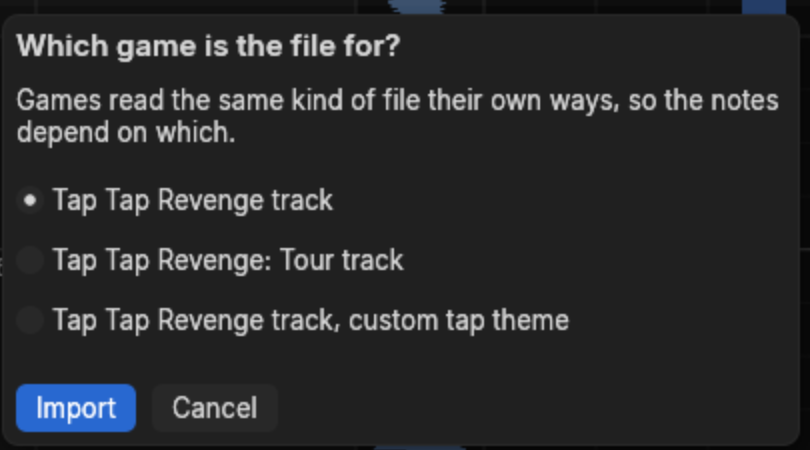

# Games, import and export

## The built-in games

A song belongs to one game, chosen when you create it, and every edit is checked against that
game's rules.

| Game | Layouts | Note kinds | Import and export |
|---|---|---|---|
| StepMania | its styles, from dance-single to pump-double and kb7-single | tap, hold, roll, mine, lift, fake | not yet |
| Tap Tap Revenge | 3, 4 or 5 lanes; a song's levels may differ | tap, hold, shake, slice, mega tap | `.ttr2_track` and Editor on Fire MIDI |
| osu!mania | 1 to 10 keys, or an even count up to 20 | tap, hold | timing from `.osu` |

What each one allows:

- **StepMania** charts take a difficulty from their name, such as `Hard`, and keep a meter and a
  description.
- **Tap Tap Revenge** charts are levels: Easy, Medium, Hard and Extreme. A shake sits in the
  lane of its direction — left in the first lane, right in the last, down in the middle. Slices
  go left or right, and a mega tap covers every lane. Shakes, slices and mega taps may share a
  lane with a tap or hold. The song and each level name a theme, `TTRDJ` unless you set one.
- **osu!mania** charts keep HP and OD, and their timing can carry scroll speeds, osu!'s green
  lines.

## Tap Tap Revenge

### Importing

**File > Import song…** opens a `.ttr2_track` or an Editor on Fire `.mid` as a new, unsaved
song. Its audio is the file the track names beside it, and the `info.plist` of a track's folder,
where there is one, supplies the title, artist, genre, themes and each level's lane count.

The same file means different notes in different games, because the theme decides what each key
is, so charter asks:

| Choice | Keys 61 and 63 | Key 65 |
|---|---|---|
| Tap Tap Revenge track | left and right shakes | down shake |
| Tap Tap Revenge: Tour track | left and right slices | mega tap |
| Tap Tap Revenge track, custom tap theme | taps in the left and right lanes | tap in the middle lane |
| Editor on Fire MIDI | left and right shakes | down shake |
| Tap Tap Reloaded MIDI | none | mega tap, on the level's key 4 |

Keys 60, 62 and 64 are taps in the three lanes, and holds when held over 0.15 seconds. Four and
five lanes take the keys from 60 up, left to right. In MIDI, Easy is keys 60 to 71, Medium 72 to
83, Hard 84 to 95 and Extreme 96 to 107, on the track named `PART GUITAR`.

### Exporting

**File > Export song…** writes the open song in the chosen game's format. For a track, first
make an empty folder such as `Anthem.track`, enter it in the save dialog and choose
`taptrack.ttr2_track`. Charter writes these files directly into the chosen file's parent folder:

- `taptrack.ttr2_track`, the levels;
- `info.plist`, the title, artist, genre, levels, their lanes and themes, and the song's length;
- `audio.m4a`, the audio in an MP4 container. AAC already in MP4 is copied; AAC in another
  container, and MP3, are remuxed without re-encoding by [ffmpeg](https://ffmpeg.org)
  (`-vn -c:a copy -f mp4`). Anything else is encoded as AAC at 320 kbps (`-c:a aac -b:a 320k`).
  Charter probes the source codec rather than trusting the filename. Without ffmpeg when
  conversion is needed, the rest still exports and a message says the audio was not written;
- `artwork.png` at 80x80 and `artwork@2x.png` at 160x160, from PNG or JPEG artwork, scaled to
  fit and centred on a transparent square without cropping. Both files are PNG.

The filename you choose is ignored for a track: picking `Anthem.ttr2_track` still writes
`taptrack.ttr2_track` beside it, and does not create an `Anthem.track` folder. Existing files
under those fixed names can be replaced, so export into an empty folder rather than into the
working song's own.

Importing an exported track folder restores the game's notes, timing, metadata and themes,
subject to the losses below. A MIDI export leaves out the artist, genre, artwork and themes, and
levels of four or five lanes, which that MIDI layout cannot represent.

### What a conversion loses

Both directions report the losses they know about, such as notes the chosen game plays another
way, charts that are not one of the four levels, markers and the preview.

**Current gap:** an export merges all layers and drops their names, colours, visibility and
locks without reporting that loss. Keep the charter JSON as the editable original — a game
export is not a complete backup of it.

## osu!mania

osu! beatmaps do not import yet. Their timing does, into a song of any game: see
[importing timing](timing.md#importing-timing).
