# Getting started

## Installing

Builds for 64-bit Linux and Windows are on the project's
[releases page](https://github.com/cN3rd/charter/releases), one for every change to the main
branch. Download `charter-<version>-linux-x86_64.tar.gz` or `charter-<version>-windows-x86_64.zip`,
unpack it anywhere and run `charter` or `charter.exe`. There is no installer, and the program needs
no files beside it: its sounds and fonts are built in. The `licenses` folder holds the licences of
everything it includes.

Two features need more than that:

- [ffmpeg](https://ffmpeg.org) converts the audio when you export a Tap Tap Revenge track.
  Charter checks the binary set under Settings > Sounds first, then the `PATH`. If neither runs,
  it offers help at first start: a verified release download on Windows or macOS, or a package
  manager command to copy on Linux. Settings can open that help again.
- A graphics card makes Mapperatorinator, one of the two automatic timing finders, usable.
  Without one it runs on the processor instead, much more slowly.

To build charter yourself, install Rust, and on Linux `clang`, `mold` and the ALSA headers
(`libasound2-dev` on Debian and Ubuntu), then run `cargo run --release -p charter-app` in a clone
of the repository. [Packaging](../packaging.md) covers release builds.

## The first screen

With no song open, charter lists the ways to start on the left and the songs you opened last on
the right.

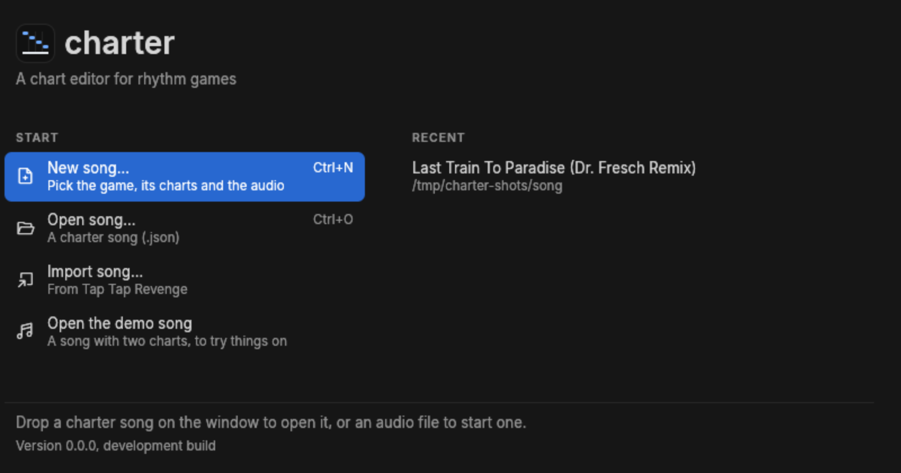

**Open the demo song** needs no files of its own: it is a made-up song with two charts, a tempo
change, a stop and a spell of 7/8, and it is the safest thing to try an unfamiliar command on.
Help > Open the demo song opens it again later.

Each recent song shows the folder it lives in, with the whole path on hover. A song stays in the
list after a permission error or a drive that was not plugged in, so you can try it again; only a
file the system reports as missing drops out.

Under Windows and X11 you can also drop files on the window: a `.json` song opens it, and an
audio file starts a new song around that audio. Wayland cannot deliver dropped files to charter
yet, so there the window offers its buttons instead.

## Opening a song

| To open | Do this |
|---|---|
| A charter song | **File > Open…** (Ctrl+O), or pick it from the first screen |
| One you had open before | **File > Open recent** |
| A song named on the command line | `charter path/to/song.json` |
| A Tap Tap Revenge track or an Editor on Fire MIDI | **File > Import song…**, see [Games](games.md) |

A song opens for editing when charter has the plugin for its game. A song for a game it does not
know opens read-only, with a banner naming the plugin it needs; you can still select and copy its
notes, but not change them or its audio.

## The parts of the window

Five regions, from the top down.

### The menu bar

Six menus. Every command that has a key shows it beside its name, and a command greyed out is
one the open song cannot take right now.

| | |
|---|---|
| 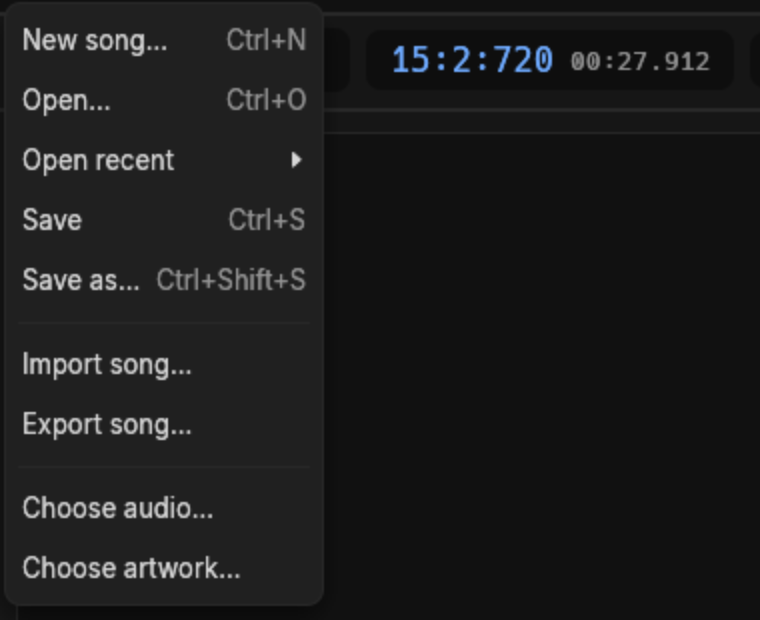 | **File** starts, opens, saves, imports and exports songs, and chooses the audio and artwork of the one that is open. |
| 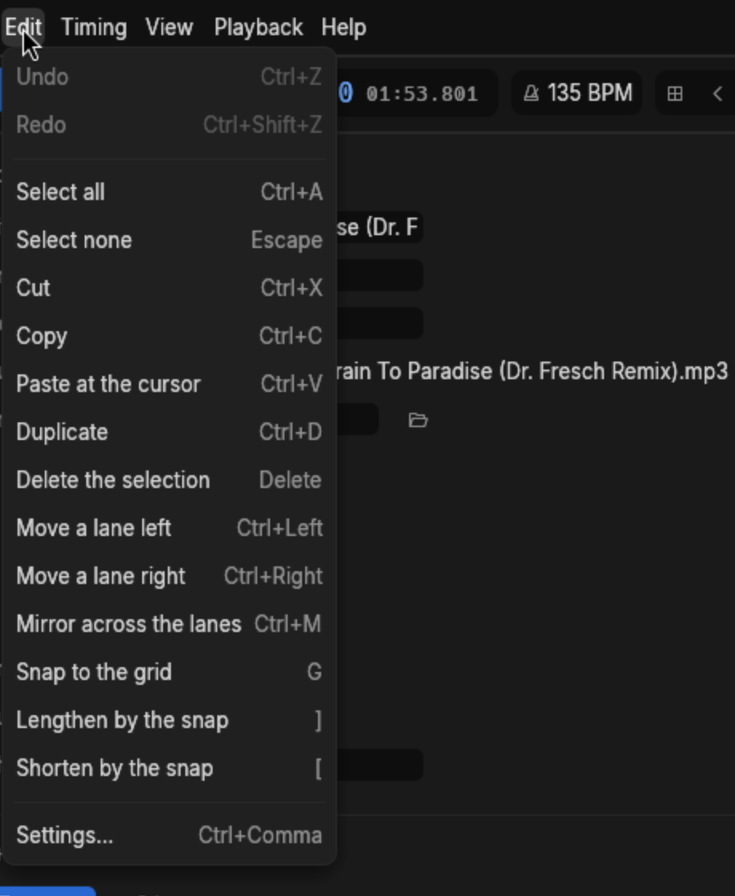 | **Edit** is undo, the selection, and every edit that acts on it. Settings… sits at the bottom. |
| 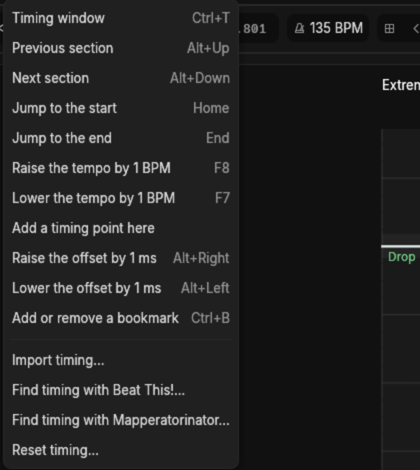 | **Timing** moves the cursor by section, nudges the tempo and offset, and opens the timing window and the two automatic finders. |
| 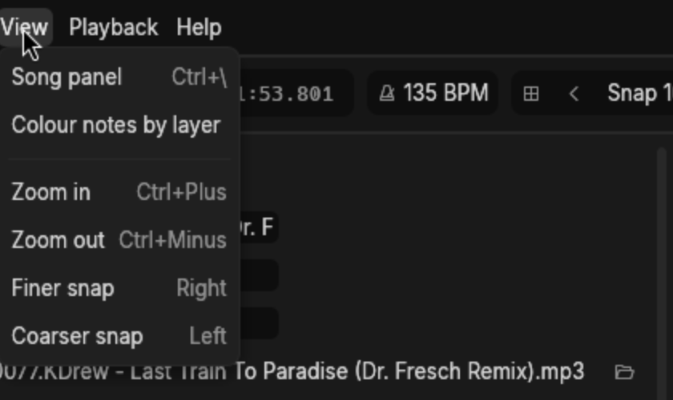 | **View** hides the song panel, tints notes by layer, and changes the zoom and snap. |
| 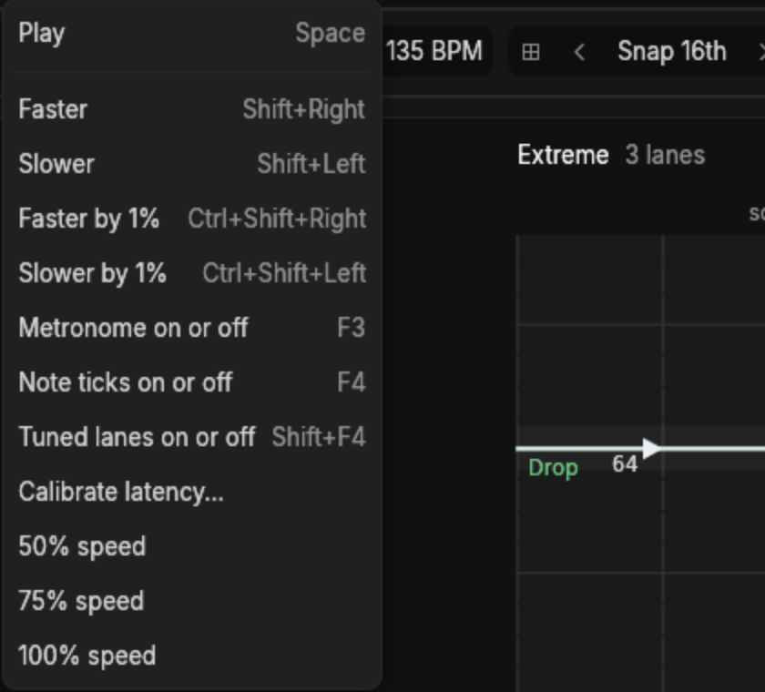 | **Playback** plays, changes the speed, and turns the metronome and note ticks on and off. |
| 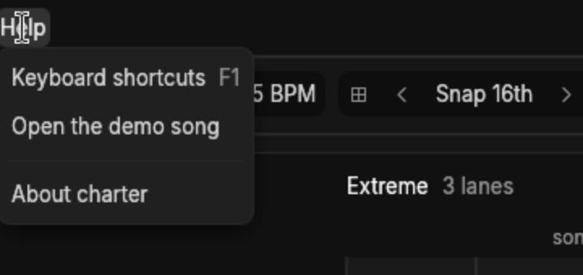 | **Help** is the shortcut list, the demo song and the About window. |

F1 opens the shortcut list at any time, with a filter box;
[Keyboard shortcuts](shortcuts.md) is the same list on a page. Help > About charter gives the
version, the source commit and, for CI builds, the prerelease tag (such as `ci-42`). Include that
line in bug reports. The window also gives the licence and credits:

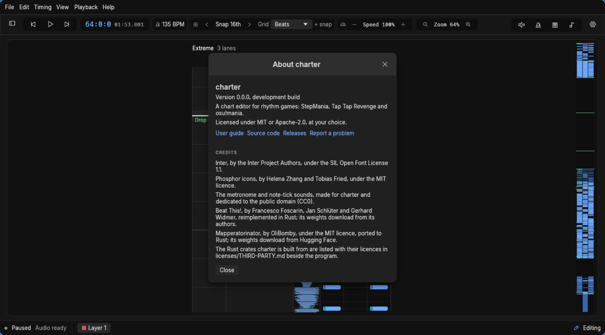

### The transport toolbar

- The **readout** is where the cursor is, twice over: `64:0:0` is measure 64, beat 0, tick 0, and
  `01:53.801` is the same place in the audio.
- **135 BPM** is the tempo in force at the cursor, not the song's average.
- **Snap 16th** is how far one press of Up or Down moves the cursor. The arrows beside it, and
  the Left and Right keys, make it coarser or finer.
- **Grid** chooses how many lines the notefield draws between beats. When the snap lands between
  those lines, `+ snap` appears and the notefield draws the snap's lines as well.
- **Speed** and **Zoom** change how the song plays and how close the notefield sits. Neither
  touches the chart.
- On the right: the volumes, the metronome, tuned lanes, note ticks and the settings window.

As the window narrows the toolbar drops controls rather than squeezing them: zoom and grid go
below 1200 points of width, speed below 950, and the tempo and snap below 800. The menus still
have all of them.

### The song panel

Everything about the song that is not a note: its title and audio, its charts, its layers, its
timing and its markers. Ctrl+\\ folds it away when you want the room.
[Charting](charting.md#the-song-panel) goes through it section by section.

### The notefield

The middle of the window, and where the chart actually is.

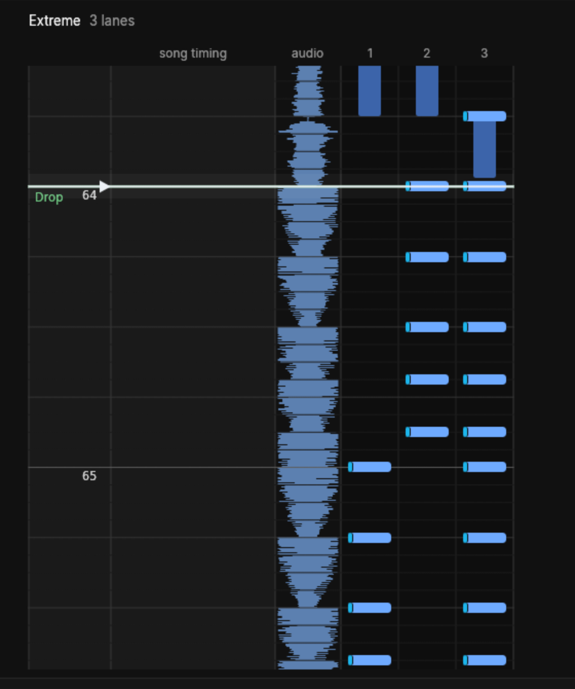

From left to right: the **ruler** with measure numbers and section names, the **song timing**
column where each timing point draws its line, the **audio** strip, and then the **lanes**. The
bright line across all of them is the cursor. Time runs downward to start with, so the notes
below the cursor come later in the song; the Display settings can turn the notefield the other
way up, or on its side.

The **minimap** down the right edge shows the whole chart at once, its notes by lane and its
sections as green lines. Click or drag it to jump.

### The status bar

Whether the song is playing, whether its audio is ready, which layer new notes go on, how many
notes are selected, and whether the song can be edited at all. Click the layer name to switch
layers.

Messages appear over the notefield rather than in the status bar, each with a button to dismiss
it:

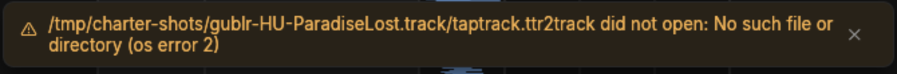

## Starting a song of your own

**File > New song…** (Ctrl+N) asks for the game first, because the game decides what the rest of
the dialog offers.

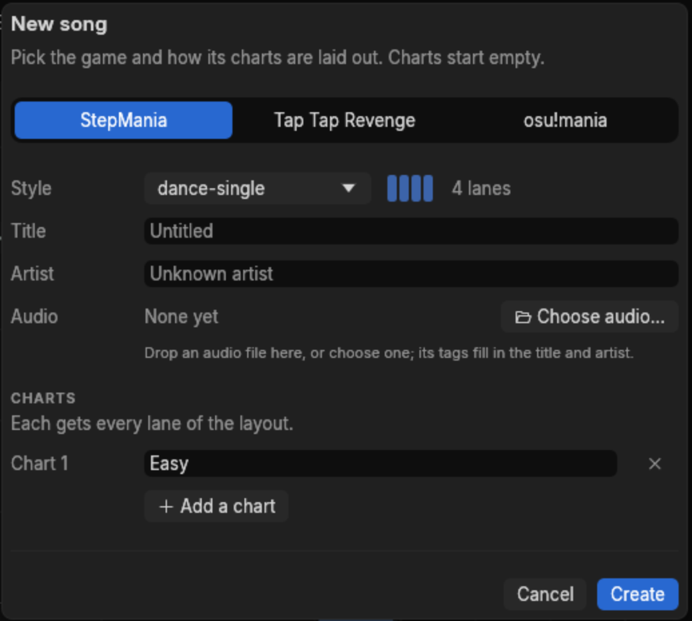

- **StepMania** asks for a style, from dance-single to pump-double, and you name each chart.
- **Tap Tap Revenge** asks for a lane count and which of its four levels to make, with presets
  for the usual sets.

- **osu!mania** asks for a key count.

The title and artist fill themselves in from the audio file's tags. The audio can be dropped on
the dialog, chosen with its button, or left until later.

A new song starts at 120 BPM in 4/4 with no notes, and lives only in memory until you save it.
**Save** (Ctrl+S) the first time asks where, and turns the song into a folder: choosing `Anthem`
writes `Anthem/Anthem.json` with a copy of the audio beside it.

Next: [your first chart](first-chart.md), start to finish.
