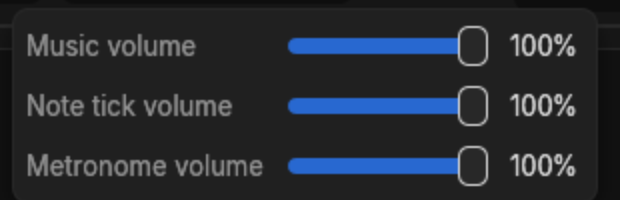
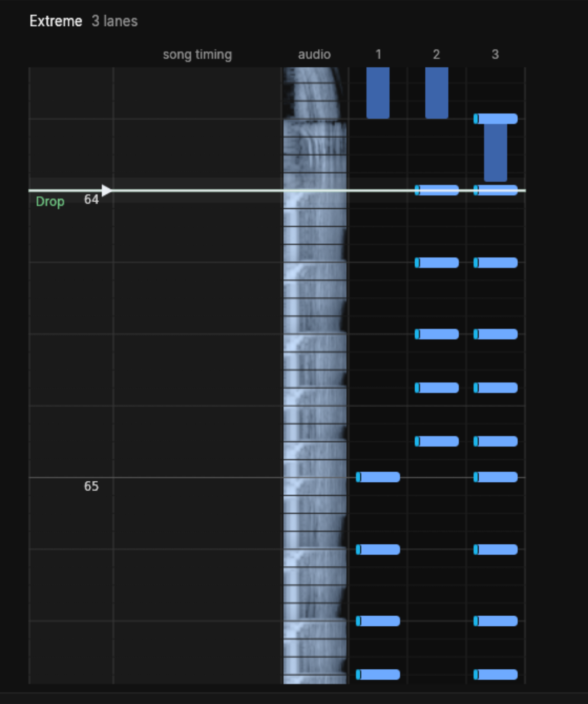
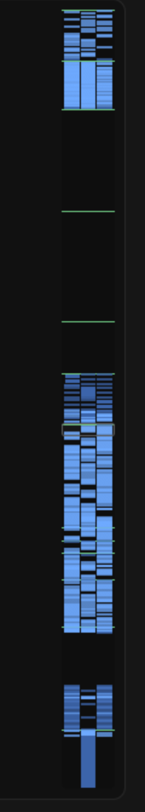
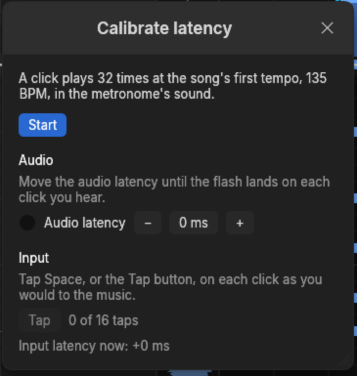

# Listening

Charting is mostly listening. These are the controls that let you hear what you have made.

## Playing

Space plays from the cursor and pauses. The cursor follows the playback, and moving the cursor
while playing jumps the playback there.

Q plays a moment just before the cursor and W a moment just after it, then stops with the cursor
where it was. That is the fastest way to decide whether one note is early: park the cursor on it
and press Q and W until you are sure. The moment is 200 ms long unless the Sounds settings page
says otherwise, anywhere from 50 ms to a second.

The status bar says whether the audio is ready, still loading, missing or unreadable. A song's
audio can be an Ogg, MP3, WAV or FLAC file; AAC, M4A and MP4 files can be chosen as well.

## Speed

Shift+Left and Shift+Right play 10% slower or faster, Ctrl+Shift+Left and Ctrl+Shift+Right 1%,
anywhere from 10% to 400%. The Playback menu and the toolbar change it too, and the chart itself
is untouched. From 10% to 200% the audio keeps its pitch unless Keep pitch is off on the Sounds
page; outside that range its pitch follows its speed.

The metronome and note ticks keep their own speed and pitch, so a tick at 25% sounds as sharp as
at 100%.

## Metronome and note ticks

- The **metronome**, F3, clicks on every beat and accents the first of each measure. The Sounds
  page has nine click sounds, each with a preview.
- **Note ticks**, F4, sound on every note as it passes: a click, a beep, or one of four hit
  sounds. With them on you hear the chart against the song, which makes a note off the beat
  obvious.
- **Tuned lanes**, Shift+F4 or the piano-keys button beside the note ticks, give each lane's
  tick a pitch of its own, lowest on the left, so a pattern can be heard as a tune.

Each of the three has its own volume, behind the toolbar's speaker button; the Sounds settings
page adds a fourth, for the clicks the metronome makes between beats.

Ticks are mixed into the music before it plays, so they never drift from it. The cost is that
with any tick on, a volume changed during playback only takes effect once you let the slider go.

Hidden and ghosted [layers](../layers.md) make no ticks.

## Seeing the audio

Once the audio loads, its waveform draws in a strip beside the lanes, lined up with the notes.
Turn on **Frequencies** on the Display settings page and the strip shows the audio's spectrum
instead — low pitches on the left, high on the right, brighter the louder — so a kick and a
hi-hat that sound together show up apart:

On a narrow canvas the strip disappears, to keep every lane in view.

The minimap beside the notefield shows the whole chart: its notes by lane, ghosted notes
faintly, and its sections as green lines. Hidden notes disappear from it. A box marks what the
notefield is showing, and a click or drag moves the cursor there.

## Latency

Sound reaches your ears a little after the computer plays it, and a key press reaches the
computer a little after you make it. Until both are measured, the cursor sits a little off what
you hear and notes recorded during playback land late. Open **Playback > Calibrate latency**, or
the Sounds page's Calibrate…:

1. Press **Start**. A click plays over and over at the song's first tempo.
2. **Audio**: move the audio latency until the flash lands on each click you hear. The cursor
   then shows what is heard rather than what is being played.
3. **Input**: tap Space, or the Tap button, on each click, sixteen times. The input latency is
   how late your taps come, and notes placed during playback go that much earlier to match.

The calibration is kept across runs, and Restore defaults in the settings leaves it alone.
