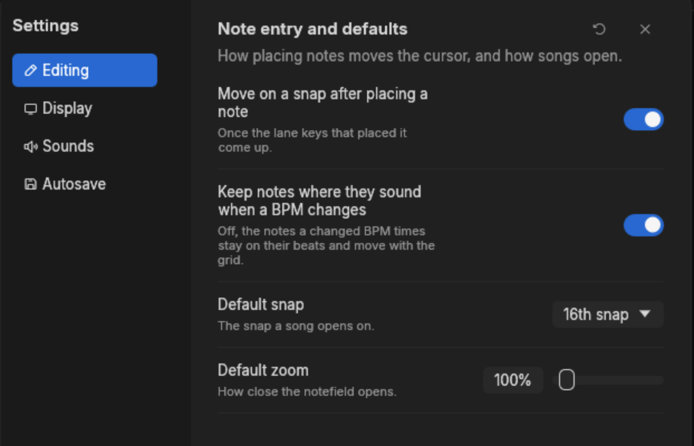
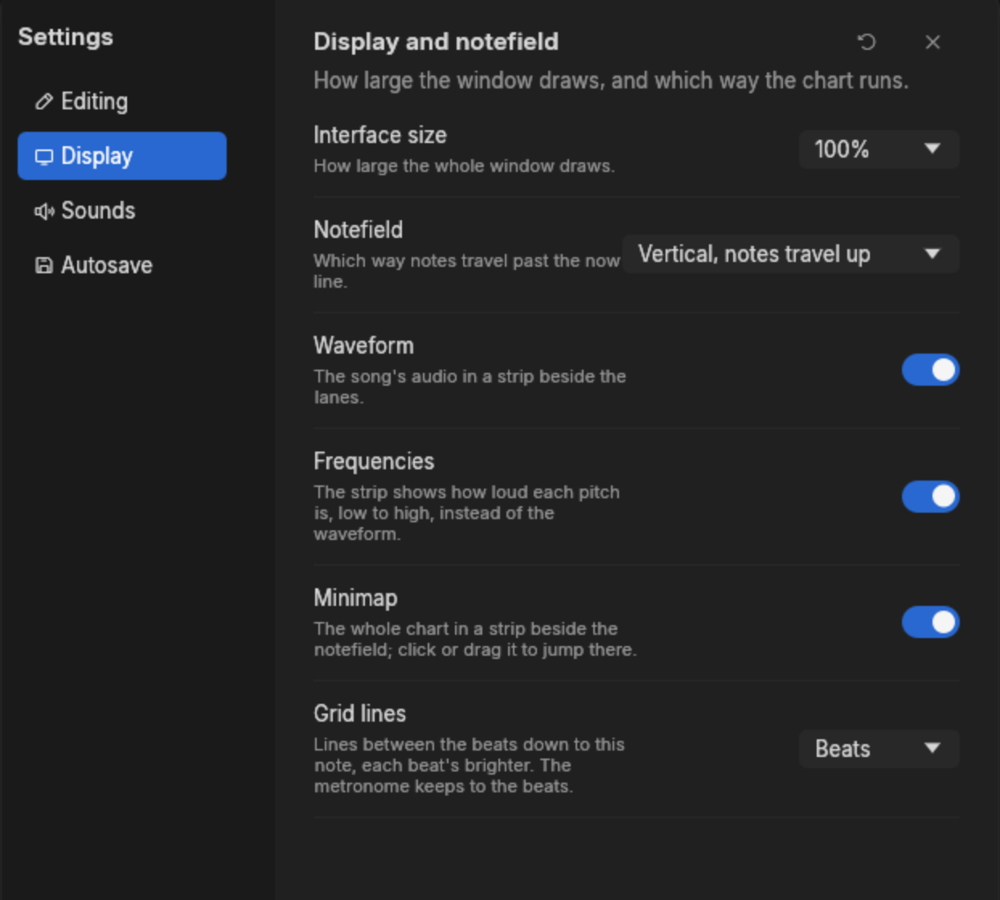
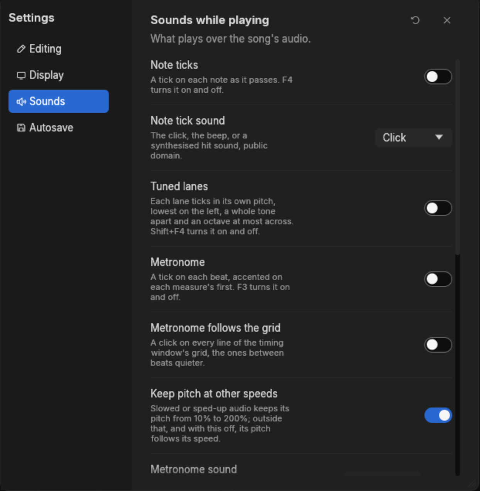
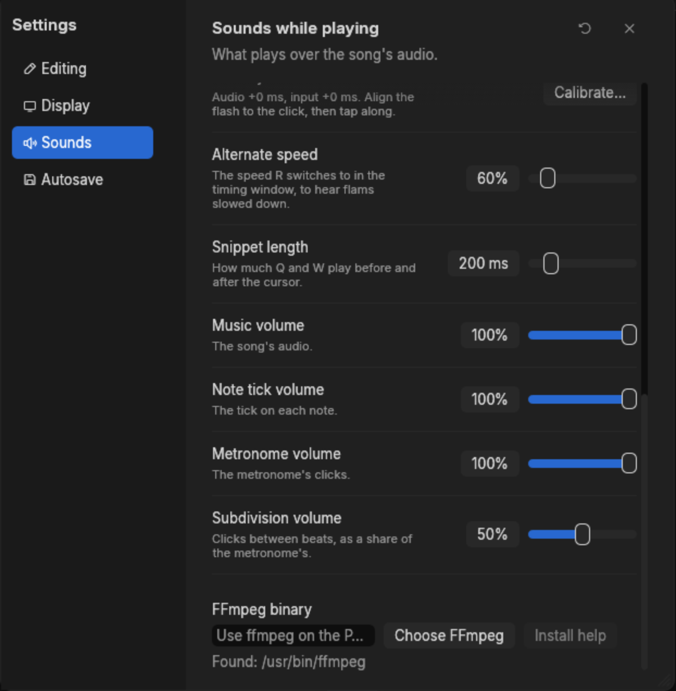
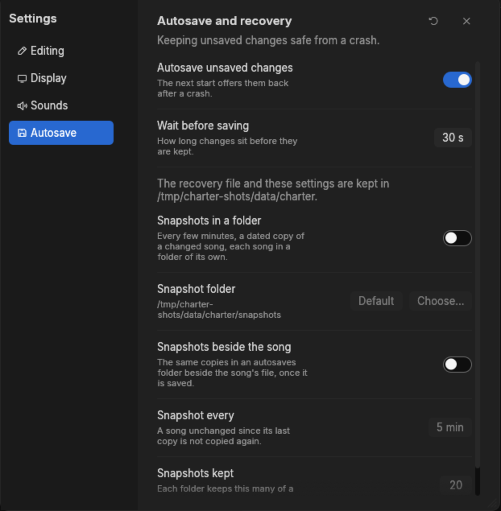

# Settings

**Edit > Settings…**, or Ctrl+Comma, opens the settings window. Changes take effect at once and
are remembered between runs. Restore defaults, beside the close button, asks before resetting
every setting on every page, and Cancel or Escape in that confirmation leaves them as they were;
the latency calibration, the recent songs and whether ffmpeg installation help was already
offered survive a reset.

The window is modeless: opening it does not stop you editing the chart behind it, and lane keys
still place notes as long as no text field has the keyboard.

## Editing

| Setting | What it does | Range |
|---|---|---|
| Move on a snap after placing a note | Once the lane keys that placed a note come up, the cursor moves one snap on. | on to start |
| Keep notes where they sound when a BPM changes | Off, the notes a changed BPM times stay on their beats and move with the grid. See [Timing](timing.md#offset-and-timing-points). | on to start |
| Default snap | The snap a song opens on. | 16th to start |
| Default zoom | How close the notefield opens. | 12.5% to 1250% |

## Display

| Setting | What it does | Range |
|---|---|---|
| Interface size | How large the whole window draws. | 75% to 200% |
| Notefield | Which way notes travel past the now line: vertically up or down, horizontally left or right. | up to start |
| Waveform | The song's audio in a strip beside the lanes. | on to start |
| Frequencies | The strip shows how loud each pitch is instead of the waveform. Needs Waveform on. | off to start |
| Minimap | The whole chart in a strip beside the notefield. | on to start |
| Grid lines | How finely the notefield draws between beats: beats, or 8th, 12th, 16th, 24th, 32nd or 48th notes. Where the snap falls between those lines, the snap's lines are drawn too. | beats to start |

## Sounds

| Setting | What it does |
|---|---|
| Note ticks, Note tick sound | A sound on every note as it passes, and which: a click, a beep, or one of four hit sounds. |
| Tuned lanes | Each lane's tick at a pitch of its own, lowest on the left, a whole tone apart and an octave at most across. |
| Metronome, Metronome sound | A click on every beat, accented on each measure's first, in one of nine sounds, each with a preview. |
| Metronome follows the grid | In the timing window, a click on every grid line, the ones between beats quieter. |
| Keep pitch at other speeds | Audio played from 10% to 200% of its speed keeps its pitch. |

| Setting | What it does | Range |
|---|---|---|
| Latency | Calibrate… measures the audio and input latency. See [Listening](listening.md#latency). | -500 to +500 ms |
| Alternate speed | The speed R switches to in the timing window, to hear flams. | 10% to 400%, 60% to start |
| Snippet length | How much Q and W play before and after the cursor. | 50 to 1000 ms, 200 to start |
| Music, Note tick and Metronome volume | One level each. | 0% to 100% |
| Subdivision volume | The clicks between beats, as a share of the metronome's. | 0% to 100%, 50% to start |
| FFmpeg binary | The ffmpeg used when exporting Tap Tap Revenge audio. Leave it empty to use the `PATH`, or pick one with Choose FFmpeg. Charter shows the binary it found, or says that none runs. | |

When no ffmpeg runs at first start, charter offers installation help once; the Install help
button beside the path stays available while ffmpeg is missing. On Windows it can download a
release build from gyan.dev, on macOS from ffmpeg.martin-riedl.de, checking the published
SHA-256 before keeping just the executable in its data folder. It shows progress and reports
failures without changing your path. On Linux the dialog shows, and can copy, a command for a
package manager it finds on the `PATH`. On other systems, install ffmpeg yourself and name it
here if it lives outside the `PATH`.

## Autosave

| Setting | What it does | Range |
|---|---|---|
| Autosave unsaved changes, Wait before saving | Keeps unsaved changes where the next start finds them. | 5 to 600 s, 30 to start |
| Snapshots in a folder, Snapshot folder | Dated copies of a changed song, each song in a folder of its own. | off to start |
| Snapshots beside the song | The same copies in an `autosaves` folder beside the song's file. | off to start |
| Snapshot every | How often a changed song is copied. | 1 to 120 min, 5 to start |
| Snapshots kept | How many copies each folder keeps. | 1 to 500, 20 to start |

The page also names charter's data folder. [Files and recovery](files.md) explains what each of
these protects you from.

## How settings are kept

Only what you changed is written, to `app.ron` in the data folder. Anything you left alone keeps
following its default, so a later version that revises that default picks the new value up
quietly. A saved number outside a setting's range is brought to the nearest end when it is read,
and a setting that cannot be read at all takes its default without disturbing the others.
