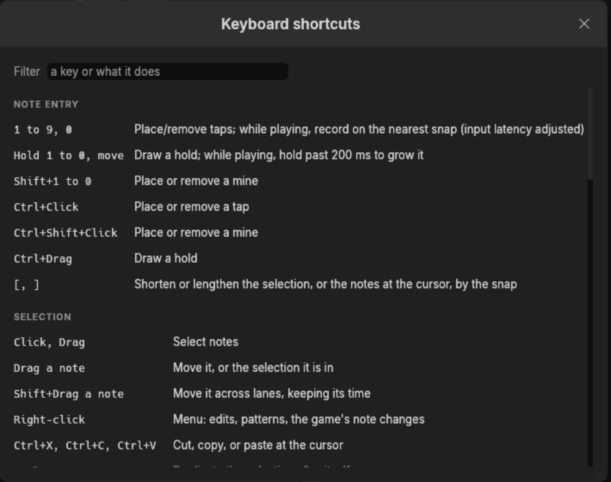
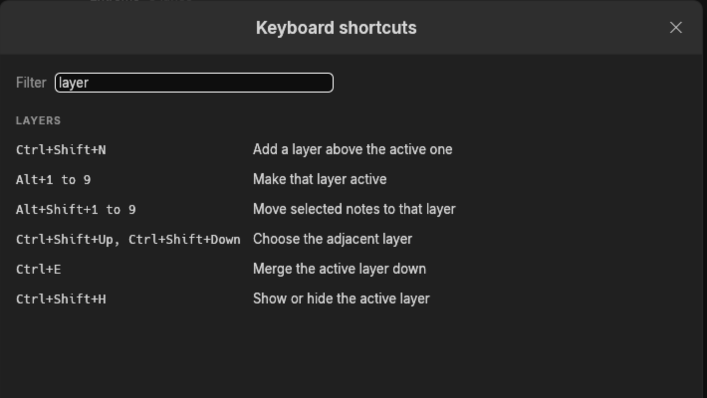

# Keyboard shortcuts

F1 shows this list inside the editor, with a filter box:

Type in the filter to narrow it to a key or to what a key does:

Settings, this window and Import timing are modeless. Opening them does not stop you editing the
song behind them: lane keys still place notes as long as no text field has the keyboard. The
timing window takes its own keys after a click inside it, and gives them back after a click
outside.

## Note entry

| Keys | Action |
|---|---|
| 1 to 9, 0 | Place or remove a tap; while playing, record on the nearest snap |
| Hold 1 to 0, move | Draw a hold; while playing, hold past 200 ms to grow it |
| Shift+1 to 0 | Place or remove a mine |
| Ctrl+Click | Place or remove a tap |
| Ctrl+Shift+Click | Place or remove a mine |
| Ctrl+Drag | Draw a hold |
| `[`, `]` | Shorten or lengthen the selection, or the notes at the cursor, by the snap |

## Selection

| Keys | Action |
|---|---|
| Click, Drag | Select notes |
| Drag a note | Move it, or the selection it is in |
| Shift+Drag a note | Move it across lanes, keeping its time |
| Right-click | Menu: edits, patterns, the game's note changes |
| Ctrl+X, Ctrl+C, Ctrl+V | Cut, copy, or paste at the cursor |
| Ctrl+D | Duplicate the selection after itself |
| Ctrl+Left, Ctrl+Right | Move the selection a lane |
| Ctrl+Up, Ctrl+Down | Move the selection by the snap |
| Ctrl+M | Mirror the selection across the lanes |
| G | Snap the selection to the nearest snap lines |
| Shift+Click, Shift+Drag | Add to the selection |
| Alt+Click, Alt+Drag | Take from the selection |
| Ctrl+A, Escape | Select every note on shown, unlocked layers, or none |
| Delete, Backspace | Delete the selection |
| Ctrl+Z | Undo |
| Ctrl+Shift+Z, Ctrl+Y | Redo |

## Layers

| Keys | Action |
|---|---|
| Ctrl+Shift+N | Add a layer above the active one |
| Alt+1 to 9 | Make that layer active |
| Alt+Shift+1 to 9 | Move selected notes to that layer |
| Ctrl+Shift+Up, Ctrl+Shift+Down | Choose the adjacent layer |
| Ctrl+E | Merge the active layer down |
| Ctrl+Shift+H | Show or hide the active layer |

## Moving around

| Keys | Action |
|---|---|
| Up, Down, Wheel | Move the cursor by the snap |
| Page Up, Page Down, Shift+Wheel | Move the cursor by a measure |
| Middle-drag | Pan by moving the cursor; while playing, seek the audio |
| Home, End | Jump to the start, or to where the last note ends |
| Alt+Up, Alt+Down | Jump to the previous or next section |
| Left, Right | Coarser or finer snap |
| Ctrl+Wheel, Ctrl+Plus, Ctrl+Equals, Ctrl+Minus | Zoom |

## Timing

| Keys | Action |
|---|---|
| Ctrl+T | Show or hide the timing window |
| Ctrl+B | Add or remove a bookmark at the cursor |
| F7, F8 | Lower or raise the tempo at the cursor by 1 BPM |
| Alt+Left, Alt+Right | Lower or raise the offset by 1 ms, or by 10 ms with Shift |
| Shift+Escape | Stop waiting for an automatic timing search |

## Playback

| Keys | Action |
|---|---|
| Space | Play from the cursor, or pause |
| Q | Play a moment before the cursor |
| W | Play a moment after the cursor |
| Shift+Left, Shift+Right | Play slower or faster by 10% |
| Ctrl+Shift+Left, Ctrl+Shift+Right | Play slower or faster by 1% |
| F3, F4 | Turn the metronome or the note ticks on or off |
| Shift+F4 | Tune each lane's note ticks to a pitch of its own, or back |

## Files and windows

| Keys | Action |
|---|---|
| Ctrl+N | New song |
| Ctrl+O, Ctrl+S, Ctrl+Shift+S | Open, save, save as |
| Ctrl+Comma | Settings |
| Ctrl+\\ | Show or hide the song panel |
| F1 | Keyboard shortcuts |

## The timing window

These work once the timing window has the keyboard, after a click inside it. ? lists them there.

| Keys | Action |
|---|---|
| Click empty space | Add an anchor, snapped as the toolbar's Snap boxes say: to the grid, and to the strongest onset within 25 ms |
| Click an anchor | Focus it and select it alone |
| Shift+Click an anchor | Select every anchor between the focused one and it |
| Double-click an anchor | Focus it and put the keyboard in its time field |
| Middle-click | Audition the anchor under the pointer, or play from that point |
| Drag an anchor, Ctrl+Drag | Move its beat, or its moment in the audio; Shift for finer and unsnapped |
| Drag elsewhere | Select the anchors inside |
| Right-click | Menu: play from here, add an anchor here |
| Space | Play or pause |
| Enter | Play from a beat before the focused anchor; apply a fit |
| Esc | Cancel a drag or fit, then clear the selection |
| A | Add an anchor at the playhead |
| J, K | Focus the anchor before, after |
| N, Shift+N | Next, previous issue |
| Left, Right | Nudge in the audio by 1 ms, 0.1 ms with Shift, 10 ms with Ctrl |
| Up, Down | Move on the grid by one step |
| +, =, - | Tail tempo by 0.1 BPM, 1 BPM with Shift |
| 1 to 0 | Grid 1/1 to 1/32 |
| F, Shift+F | Fit tempo, fit to half BPMs |
| D, Shift+D | Double, halve the tempo |
| O | Follow the playhead |
| V | Rows of bars or rows of seconds |
| L, Shift+L | Loop the bar under the cursor, the selection |
| R | Switch to the alternate speed and back |
| C, Shift+C held | Metronome on or off; muted while held |
| ?, / | Show or hide these keys |
| Delete, Backspace | Remove the focused or selected anchors |
| Ctrl+A | Select every anchor |
| Ctrl+Wheel | Nudge the focused anchor by 1 ms, 0.1 ms with Shift |
