# Timing

Charter draws a grid of beats and measures, and notes sit on that grid. Timing is the work of
making the grid agree with the music. Do it before charting: notes placed on a wrong grid have
to move when you fix it.

## Offset and timing points

The **offset** is where beat 0 falls in the audio, in milliseconds. A **timing point** is
everything that changes at one beat: the tempo in BPM, the meter such as 3/4 or 7/8, a stop, and
any timing event the game has of its own, such as osu!mania's scroll speed.

Every tempo point is pinned to its moment in the audio, as Editor on Fire's anchors and osu!'s
red lines are. Changing one point's BPM changes how many beats fit before the next point, and
the next point stays where it sounds; everything after it — notes, events and markers — moves
along the grid with it. The notes that the changed BPM times stay where they sound as well,
while the grid moves under them. Turning off "Keep notes where they sound when a BPM changes" on
the Editing settings page keeps them on their beats instead.

## The Timing section

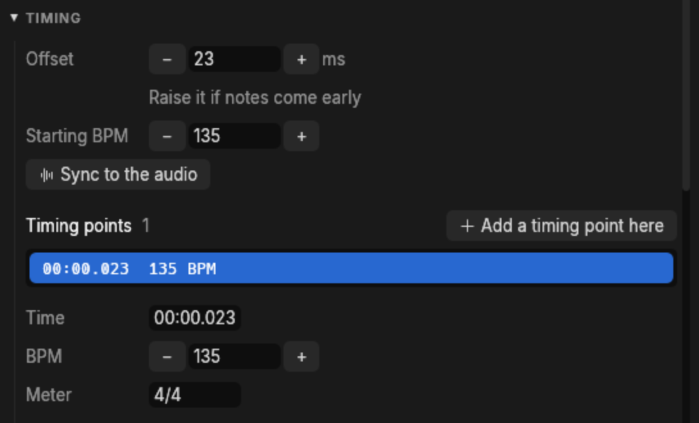

- **Offset**, stepped by 1 ms with its buttons or Alt+Left and Alt+Right, and by 10 ms with
  Shift. The hint under it says which way to go: raise it if notes come early.
- **Starting BPM**, the first point's tempo.
- **Sync to the audio** opens the timing window.
- The list of timing points, each by its moment in the audio, such as `00:00.023`. The point in
  force at the cursor is highlighted, and clicking one moves the cursor to it.
- The selected point's **Time**, **BPM** and **Meter**. A time typed for a tempo point moves it
  to that moment of the audio; for the first point that moves the whole grid, as the offset
  does. A button removes the point, except the one that starts the tempo.
- **Add a timing point here** starts one at the cursor, at the tempo already in force there.

F7 and F8 lower and raise the tempo at the cursor by 1 BPM. In the notefield, a tempo point
drags along the timing column to the moment you drop it on, keeping its beat; a meter or stop
point, and a marker on the ruler, drag to another snap line. Where marker or timing labels would
overlap, their lines stay visible and some labels are left out; zoom in, or read the label in
the panel.

## The timing window

**Timing > Timing window**, or Ctrl+T, opens a window made for nothing but syncing.

[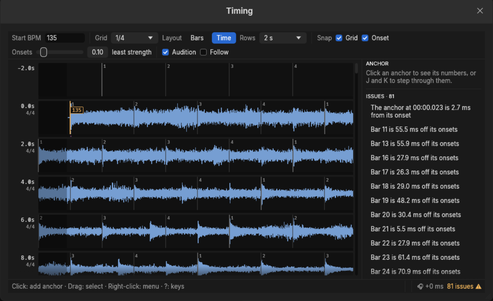](images/timing-window.png)

It lays the audio out in rows with the beat grid drawn over it: downbeats thick, beats solid,
the lines between dashed. A grid that fits the music lines up with the hits down every row.

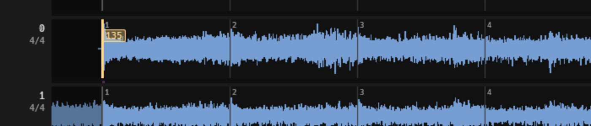

### The toolbar

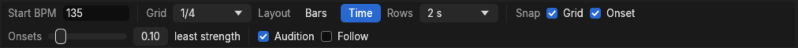

| Control | What it does |
|---|---|
| **Start BPM** | The tempo from the first anchor until the next. |
| **Grid** | How finely the window draws between beats, from 1/1 to 1/32 of a whole note. The keys 1 to 0 pick the same values. |
| **Layout: Bars** | Rows of bars. The grid stays still and the audio slides under it as you edit. |
| **Layout: Time** | Rows of seconds. The audio stays still and the grid moves. V switches between the two. |
| **Rows** | How much song one row holds: bars in the Bars layout, seconds in the Time one. |
| **Snap: Grid, Onset** | Whether a new or dragged anchor snaps to the grid, to the nearest onset, or to both. |
| **Onsets** | How strong a sound has to be to count as an onset. Raise it on a busy track to leave only the hits worth timing against. |
| **Audition** | Play from a beat before each anchor you add, with the metronome, so you hear the result at once. |
| **Follow** | Keep the playhead on the second row while playing, so the rows scroll past it. O does the same. |

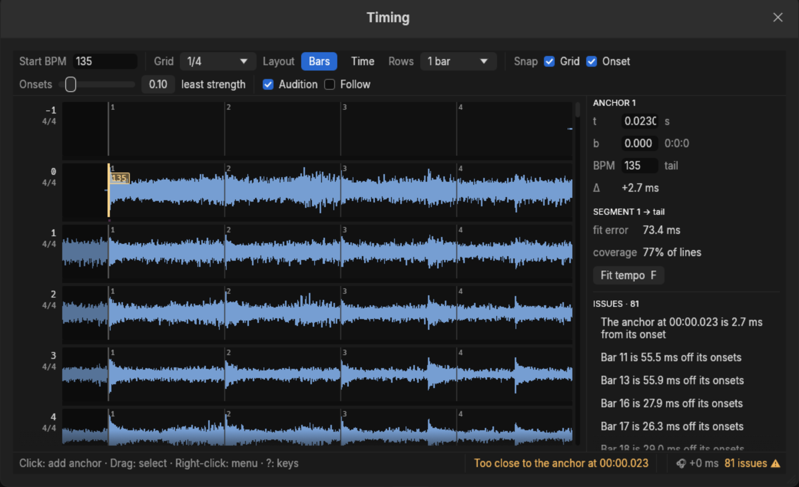

### Anchors, onsets and issues

Each BPM change is an **anchor** pinning one beat to one moment of the audio. The window finds
the **onsets** in the audio — the moments a sound starts — and measures the grid against them.
It shows ticks along each row, a strip coloured by how early or late each onset falls, and a
badge on any bar more than 5 ms off. Early onsets have a negative offset and sit in the strip's
top half; late ones are positive and sit below.

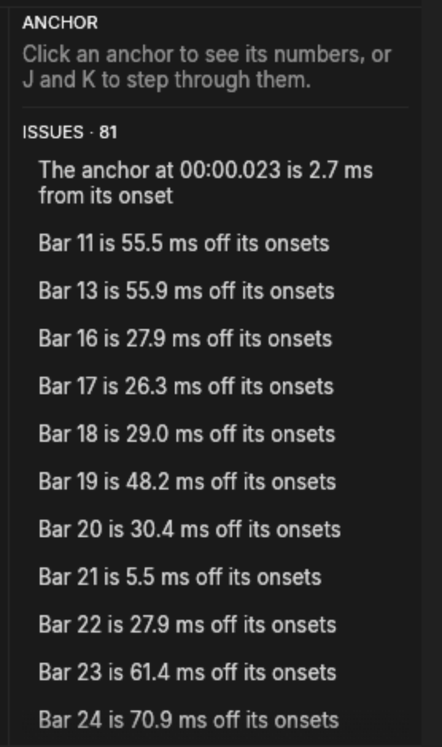

N and Shift+N step through the list. Click an anchor, or press J and K, to inspect one:

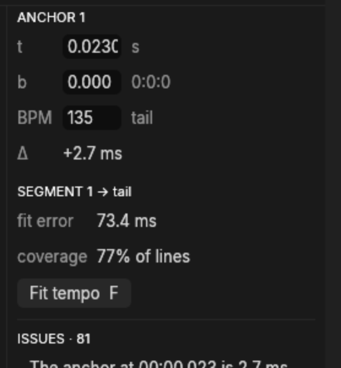

- **t** is the anchor's moment in the audio, **b** its beat, and **Δ** its distance from the
  onset it should sit on, as onset time minus anchor time.
- **fit error** and **coverage** describe the stretch of song after it: how far the grid strays
  from the onsets, and how many of the grid's lines found an onset to measure against.
- **Fit tempo**, or F, moves the tempo to the best fit; Shift+F rounds to half BPMs. The fit is
  shown before it is applied, and Enter takes it.

Tell the two faults apart. An anchor a few milliseconds off its onset is an offset error, fixed
by nudging the anchor. A fit error that grows the further you get from the anchor is the wrong
tempo, and nudging will never fix it.

### Working in the window

The window takes the keyboard after a click inside it and gives it back after a click elsewhere.
Press ? for its own list:

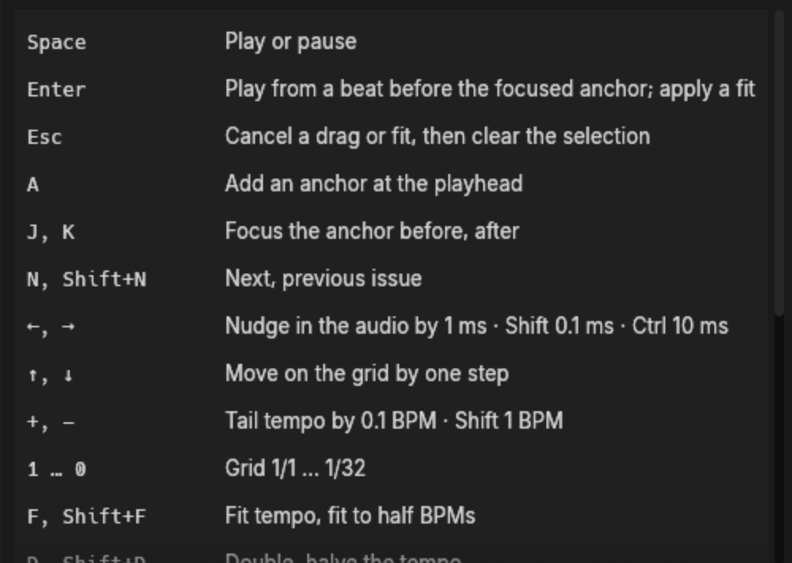

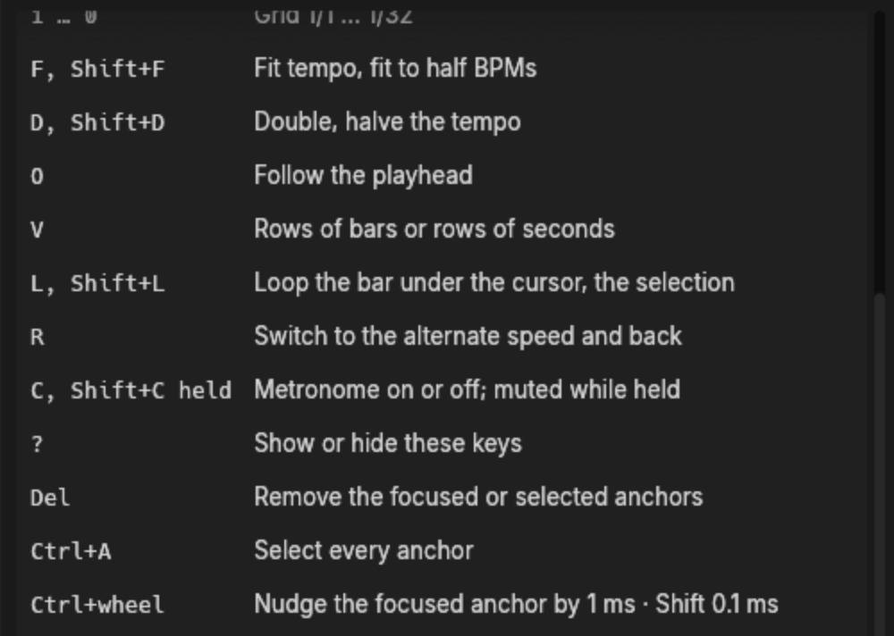

A click on empty space adds an anchor, snapped as the Snap checkboxes say: to the grid, and to
the strongest onset within 25 ms. A click on an anchor selects it instead, and a double-click
puts the keyboard in its time field. Dragging an anchor moves its beat, and Ctrl+drag its moment
in the audio; Shift makes either finer and unsnapped. Dragging elsewhere selects the anchors
between the drag's start and end, even after the starting row has scrolled away. Right-click for
the two things a point in the audio can do:

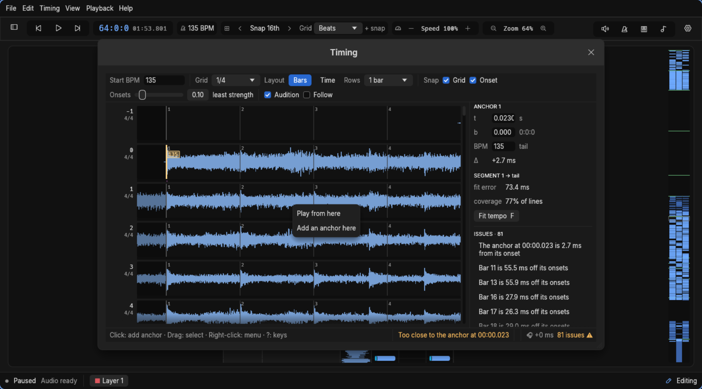

Two habits make this fast. **L** loops the bar under the cursor with the metronome, and Shift+L
the selection, so a fix plays again immediately. **R** switches to the alternate speed, 60%
unless the settings say otherwise, where a flam between the click and the kick is obvious.

## Finding timing automatically

**Timing > Find timing with Beat This!…** and **Find timing with Mapperatorinator…** listen to
the song and offer what they find.

|  | Beat This! | Mapperatorinator |
|---|---|---|
| Finds | beats and downbeats, which charter fits a tempo map to | osu! timing points directly |
| Runs on | the processor | a graphics card, or the processor if you agree |
| Downloads | 81 MB, once | 416 MB, once |

The first run of each asks before downloading its model into charter's data folder, and checks
the download against its published SHA-256 before keeping it. The song itself is never sent
anywhere.

Editing carries on while a search runs. **Shift+Esc** stops waiting and ignores the result,
though the worker may run to the end, so another search can only start after that. A timing
found after you opened another song, or changed this song's audio, is thrown away.

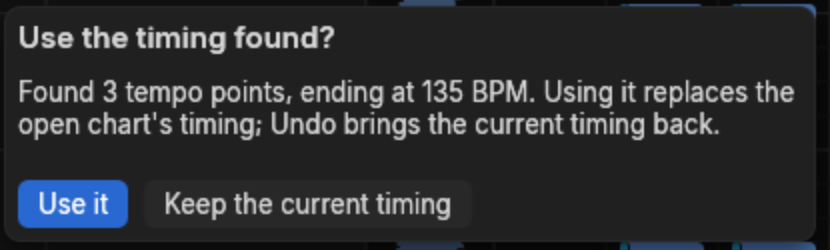

**Use it** replaces the open chart's timing as one undo step; **Keep the current timing** leaves
it alone. Check an accepted timing in the timing window before charting on it.

The menu says why a finder is disabled: `Open a song first`, `The song is read-only`,
`Choose audio before finding timing`, or `A timing search is already running`. Without a
graphics card, Mapperatorinator asks whether to run on the processor, which can take more than
fifteen minutes a song. [Automatic timing](../autotiming.md) explains how each model works and
how well.

## Importing timing

**Timing > Import timing…** reads osu!'s `[TimingPoints]`, pasted or read from an `.osu` file,
and shows what it holds before it replaces the open chart's tempo, meters and offset as one
step.

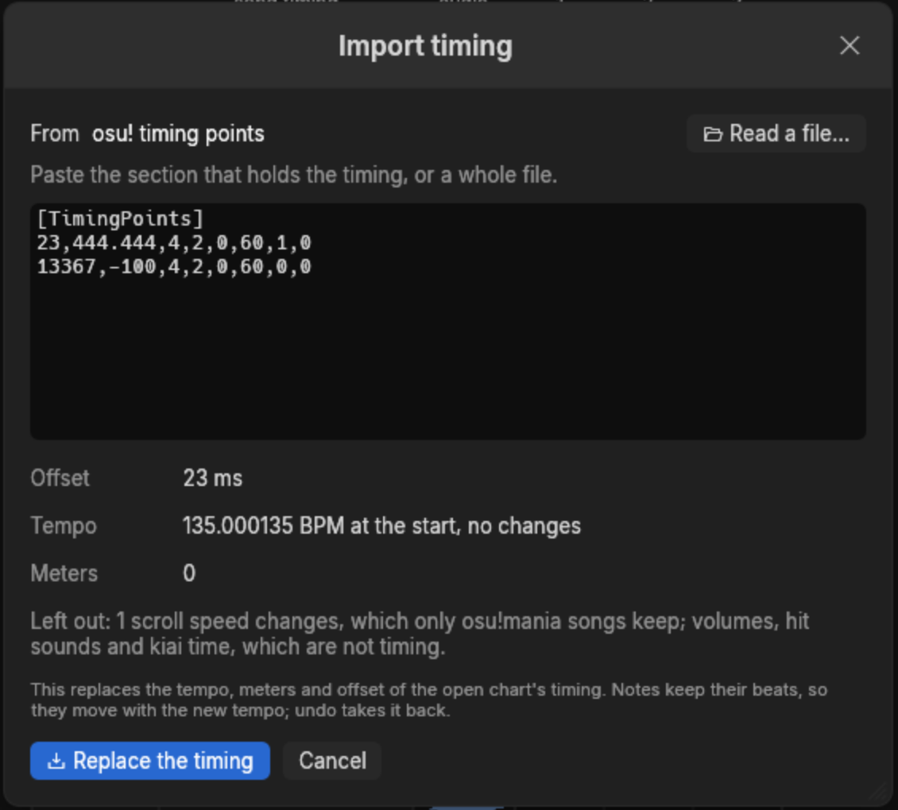

Red lines become BPM changes, with a meter wherever osu! starts a measure. Green lines become
scroll speeds in an osu!mania song and are left out of any other. The window names what it is
leaving out, such as volumes, hit sounds and kiai time.

**Timing > Reset timing…** puts 120 BPM in 4/4 from 0 ms in place of the chart's timing, after
asking. The notes keep their beats.

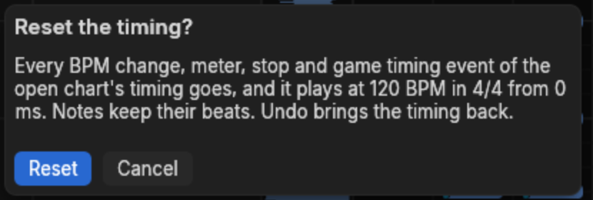
